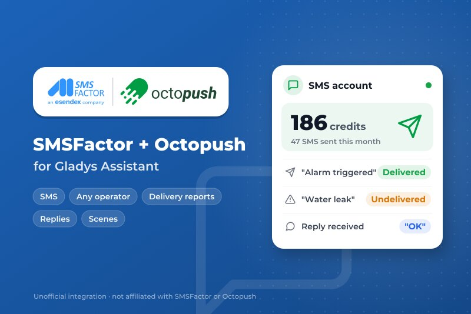
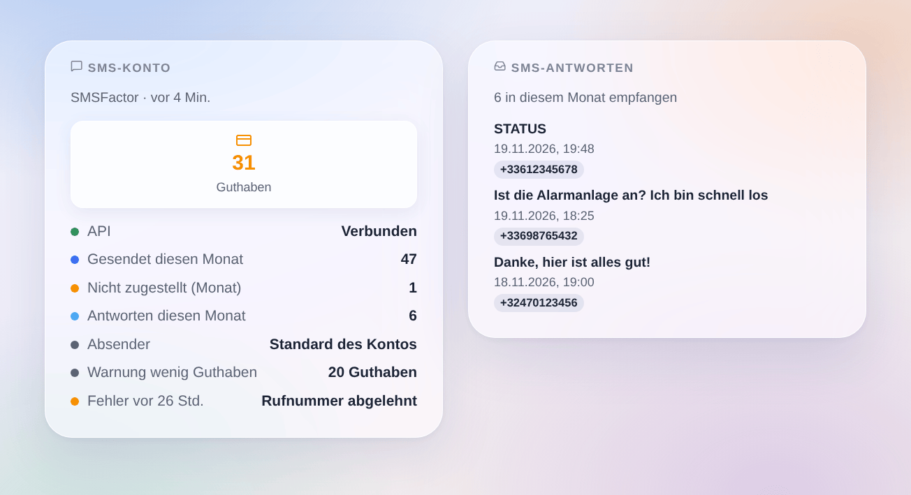
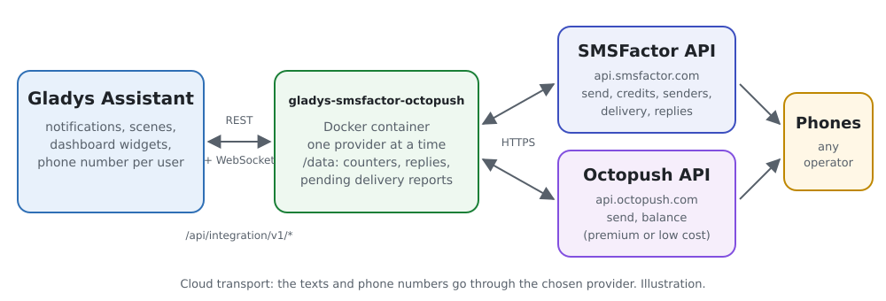
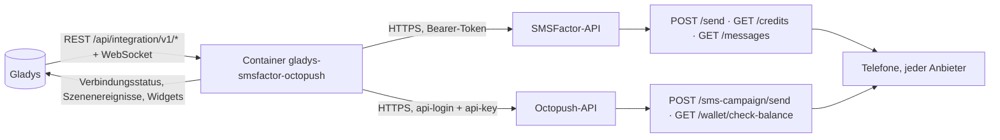
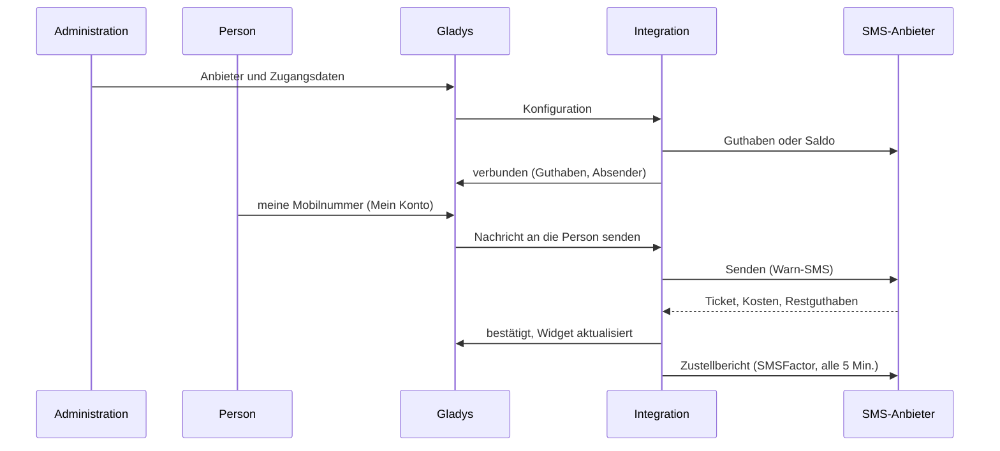

# Gladys SMSFactor + Octopush

[English](README.md) · [Français](README.fr.md) · **Deutsch** · [Español](README.es.md)

[](LICENSE)
[](https://github.com/William-De71/gladys-smsfactor-octopush/releases)
[](https://github.com/William-De71/gladys-smsfactor-octopush/actions/workflows/release.yml)
[](https://gladysassistant.com)



Externe Integration für [Gladys Assistant](https://gladysassistant.com), die die Benachrichtigungen von Gladys **per SMS über SMSFactor oder Octopush** sendet, zwei französische SMS-Gateways, an jede Mobilnummer und jeden Anbieter. Szenen können außerdem jedem eine SMS senden und auf nicht zugestellte SMS, Antworten und knappes Guthaben reagieren; zwei Widgets zeigen das Konto und die Antworten.

Benutzerdokumentation: [English](docs/en.md) · [Français](docs/fr.md) · [Deutsch](docs/de.md) · [Español](docs/es.md).

> Community-Integration, weder mit SMSFactor noch mit Octopush verbunden oder von ihnen unterstützt.

## Funktionen

- **Benachrichtigungskanal** (nur Senden): Jede Person gibt ihre Mobilnummer im Block „Mein Konto“ ein; jede an sie gerichtete Gladys-Benachrichtigung geht per SMS hinaus.
- **Zwei Anbieter**, einer in der Konfiguration gewählt: SMSFactor (API-Token) oder Octopush (Login und API-Schlüssel, Premium- oder Low-Cost-SMS).
- **Warn-SMS**: zu jeder Uhrzeit gesendet, ohne „STOP“-Hinweis; Unicode nur, wenn der Text es braucht; nationale Nummern erhalten die Standard-Ländervorwahl.
- **Szenenauslöser**: SMS nicht gesendet, SMS nicht zugestellt (SMSFactor), SMS empfangen (SMSFactor-Antworten, Filter nach Absender und erstem Wort), wenig Guthaben.
- **Szenenaktionen**: eine SMS an eine beliebige Nummer senden, das SMS-Konto lesen.
- **Dashboard-Widgets**: SMS-Konto, SMS-Antworten.
- **Schaltflächen der Konfigurationsseite**: Verbindung testen, Test-SMS senden.
- Englisch, Französisch, Deutsch und Spanisch überall.



## Funktionsweise





Von der Konfiguration zur SMS:



| Funktion                          | SMSFactor        | Octopush             |
| --------------------------------- | ---------------- | -------------------- |
| Senden, Szenenaktionen            | ja               | ja                   |
| Wenig Guthaben                    | SMS-Guthaben     | Saldo in Euro        |
| SMS nicht zugestellt              | ja (alle 5 Min.) | nein (nur Callbacks) |
| Antworten (SMS empfangen, Widget) | ja (jede Minute) | nein (nur Callbacks) |
| Liste der Absender                | ja               | nein                 |

Octopush meldet Zustellungen und Antworten nur an eine öffentliche URL, die ein Gladys zu Hause nicht hat.

### Transport

`transports: ["cloud"]`: Die Integration spricht nur mit `api.smsfactor.com` oder `api.octopush.com`. Die SMS-Texte und Rufnummern verlassen Ihr Netzwerk zum Anbieter und dann zu den Mobilfunkbetreibern.

## Benachrichtigungen und Rufnummern

| Eingegebene Nummer   | Gesendet an                                |
| -------------------- | ------------------------------------------ |
| `+33 6 12 34 56 78`  | `+33612345678`                             |
| `0033.6.12.34.56.78` | `+33612345678`                             |
| `06 12 34 56 78`     | `+33612345678` (Standard-Ländervorwahl 33) |
| `+49 151 12345678`   | `+4915112345678`                           |

SMSFactor erhält die Nummern ohne `+`. Ein angehängtes Bild wird verworfen. Ein Text mit einem Zeichen außerhalb des GSM-Alphabets (Emoji, „ê“, „œ“) wird als Unicode gesendet: 70 statt 160 Zeichen pro SMS.

## Szenenauslöser, Aktionen und Widgets

| Art      | Schlüssel         | Anwendungsfall                                                                       |
| -------- | ----------------- | ------------------------------------------------------------------------------------ |
| Auslöser | `sms_not_sent`    | Über einen anderen Kanal warnen, wenn keine SMS mehr hinausgehen (Guthaben, Ausfall) |
| Auslöser | `sms_undelivered` | Eine angenommene SMS kam nie an (SMSFactor-Berichte): anders senden                  |
| Auslöser | `sms_received`    | Auf eine Antwort reagieren: ein Stichwort wie STATUS von einer bekannten Nummer      |
| Auslöser | `credits_low`     | Das Konto aufladen, bevor es leer ist                                                |
| Aktion   | `send_sms`        | SMS an jemanden ohne Gladys-Konto (Nachbar, Babysitter) oder an mehrere Nummern      |
| Aktion   | `get_account`     | Guthaben und SMS des Monats in einem Bericht oder einer Bedingung                    |
| Widget   | `account`         | Guthaben oder Saldo, API-Zustand, SMS des Monats, Absender, Schwelle, letzter Fehler |
| Widget   | `inbox`           | Die letzten empfangenen Antworten                                                    |

Beispiele: _Alarm löst aus_ → SMS an den Nachbarn; _wenig Guthaben_ → Nachricht an die Administration; _SMS nicht zugestellt_ → dieselbe Warnung über Telegram. `sms_received` darf nie eine Tür öffnen oder eine Alarmanlage entschärfen: Der Absender einer SMS kann gefälscht sein. Eine Szenenaktion löst nie einen Auslöser aus, und `sms_not_sent` löst nur einmal aus, bis wieder eine SMS durchgeht: Eine Szene, die über denselben Kanal warnt, kann keine Schleife bilden.

## Voraussetzungen

- Gladys Assistant 5.3.0 oder neuer (Widgets und Szenen, Katalog-Stichwörter von Gladys 5.3); ältere Instanzen können die Integration nicht installieren.
- Ein SMSFactor-Konto (API-Token) oder ein freigeschaltetes Octopush-Konto (Login und API-Schlüssel), mit Guthaben.

## Installation

- **Aus dem Store**: Integrationen → SMSFactor + Octopush → Installieren.
- **Über die URL des Repositorys**: Integrationen → externe Integration → `https://github.com/William-De71/gladys-smsfactor-octopush`.
- **Entwicklermodus**: `npm start` mit den von Gladys gelieferten Variablen starten (siehe Entwicklung).

## Konfiguration

| Feld                        | Standard  | Bedeutung                                                       |
| --------------------------- | --------- | --------------------------------------------------------------- |
| Anbieter                    | SMSFactor | SMSFactor oder Octopush                                         |
| SMSFactor-API-Token         | —         | `secret`, aus Entwickler → API-Tokens                           |
| Octopush-Login              | —         | Die E-Mail-Adresse des Kontos                                   |
| Octopush-API-Schlüssel      | —         | `secret`                                                        |
| Octopush-SMS-Typ            | Premium   | Premium oder Low Cost (nur Frankreich, ohne eigenen Absender)   |
| Absender                    | Standard  | 3 bis 11 Buchstaben oder Ziffern                                |
| Standard-Ländervorwahl      | 33        | Wird Nummern ohne Vorwahl vorangestellt                         |
| Warnung bei wenig Guthaben  | 20 / 2 €  | Schwelle von `credits_low`: SMS-Guthaben oder Euro bei Octopush |
| Antworten lesen (SMSFactor) | aus       | Jede Minute, für `sms_received` und das Antworten-Widget        |
| Mein Konto → Nummer         | —         | Pro Person: die Mobilnummer ihrer Benachrichtigungen            |

## Verwendung

1. Wählen Sie den Anbieter, tragen Sie seine Zugangsdaten ein und klicken Sie auf **Verbindung testen** und **Test-SMS senden**.
2. Jede Person gibt ihre Mobilnummer unter **Mein Konto** ein.
3. Fügen Sie die Widgets einem Dashboard hinzu und bauen Sie Szenen mit den Auslösern und Aktionen.

## Entwicklung

```bash
npm install
npm test                       # node --test, nie mit Netzwerk
npm run lint                   # ESLint
npm run format:check           # Prettier
npx github:GladysAssistant/integration-store . --skip-image-check
scripts/build-cover.sh         # cover.jpg aus docs/assets/cover.svg
docs/illustrations/render.sh   # docs/assets/widgets.<Sprache>.png
```

Lokal liest das SDK `GLADYS_HOST_API_URL`, `GLADYS_INTEGRATION_TOKEN` und `GLADYS_INTEGRATION_SELECTOR` (von Gladys im Entwicklermodus geliefert). `DEBUG=gladys-integration-sdk` zeigt die Protokolle des SDK.

Die Tests decken beide Fehlerformate ab (`status` von SMSFactor in HTTP 200, `{ code, message }` von Octopush), die Fehlerursachen, die Wiederholungen (nur 429 und 503, eine Octopush-`request_id` für alle Versuche), die Pariser Datumsangaben von SMSFactor, das GSM-Alphabet, die Rufnummern, die Szenenereignisse und ihre Übergänge, Antworten und Zustellberichte über einen Neustart hinweg, die Widgets (`validateWidgetContent`), das Manifest, die vier Sprachen, das Release-Skript und die ganze Integration gegen den Fake-Gladys des SDK und gefälschte SMSFactor- und Octopush-APIs. `test/structure.test.js` friert alle Schlüssel ein, die Personen speichern.

## Release-Prozess


Jeder Merge auf `main` startet die CI und berechnet dann die Version aus den [Conventional Commits](https://www.conventionalcommits.org/de/) seit dem letzten Tag: `feat` → Minor, `fix` / `perf` → Patch, `!` oder `BREAKING CHANGE` → Major (unter 1.0.0 ein Minor); `docs`, `chore`, `ci`, `test`, `style`, `refactor`, `build` allein veröffentlichen nichts. Der Changelog-Abschnitt wird erzeugt, der Tag gepusht, das Multi-Architektur-Image gebaut, dann erhält `main` den Release-Commit, das GitHub Release wird erstellt und ein letzter Job prüft das öffentliche Image, den Store-Validator und das Topic.

- Der Titel des Pull Requests wird zum Squash-Commit und dann zur Changelog-Zeile: Schreiben Sie ihn auf Englisch, für die Nutzer (`pr-title.yml` prüft ihn). `CHANGELOG.md` nie von Hand bearbeiten.
- 1.0.0 ist eine Entscheidung: Actions → Release → Run workflow mit `release-as: 1.0.0`. `dry-run` zeigt Version und Notizen, ohne zu veröffentlichen.
- **Geschützter Branch**: Rulesets verlangen einen Pull Request auf `main` und sperren die `v*`-Tags; nur der Maintainer und Deploy Keys kommen durch. Das Release pusht mit dem Deploy Key der Umgebung `release` (Secret `RELEASE_DEPLOY_KEY`, nur `main`): Ein Lauf von einem anderen Branch erhält ihn nie. `build.yml` und `github-release.yml` starten nicht bei einem Tag: Das Release ruft sie auf, oder starten Sie sie von Hand (Actions → Run workflow, mit `version` für das Image), um ein Release abzuschließen.
- Machen Sie nach dem ersten Release das `ghcr.io`-Paket öffentlich (Package settings → Change visibility), sonst kann Gladys es nicht herunterladen.

## Fehlerbehebung

Siehe [docs/de.md](docs/de.md#fehlerbehebung). Melden Sie Probleme mit den Versionen von Gladys und der Integration, dem Anbieter, der Art des Absenders und den Protokollen der Integration (Rufnummern sind maskiert; fügen Sie nie Token oder Schlüssel ein).

## Mitwirken

Issues und Pull Requests sind willkommen. Führen Sie vor einem Pull Request `npm run format:check && npm run lint && npm test` aus und ändern Sie keinen gespeicherten Schlüssel (siehe [CLAUDE.md](CLAUDE.md)).

## Sicherheit

Siehe [SECURITY.md](SECURITY.md): Melden Sie Schwachstellen vertraulich. Das SMSFactor-Token und der Octopush-API-Schlüssel sind `secret`-Felder, werden nur in Headern gesendet, nie protokolliert, nie in einer URL, einem Szenenereignis oder einer Fehlermeldung; Rufnummern sind in den Protokollen maskiert. Ein SMSFactor-Versand wird nach einer Zeitüberschreitung nie wiederholt, damit eine Warnung nicht doppelt hinausgeht; Octopush-Sendungen tragen eine Anfrage-ID, die Octopush kein zweites Mal annimmt.

## Kommende Screenshots

Die Bilder oben sind Illustrationen, keine Screenshots. Echte Screenshots kommen nach `docs/assets/screenshots/` (PNG, 1280 × 800): `configuration.png`, `my-account.png`, `scene-trigger.png`, `dashboard.png`.

## Lizenz

[Apache License 2.0](LICENSE) — siehe auch [NOTICE](NOTICE). SMSFactor und Octopush sind Marken ihrer jeweiligen Inhaber; diese Community-Integration ist nicht mit ihnen verbunden. Danke an die Dokumentation und das SDK von Gladys.
