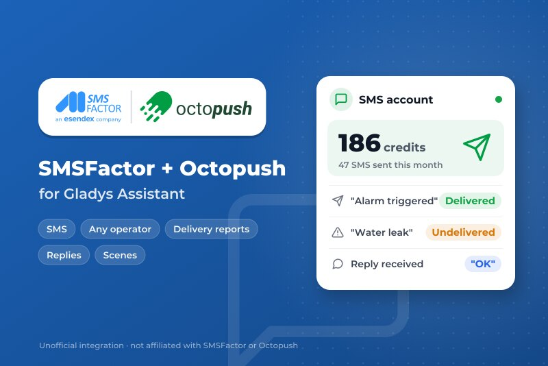
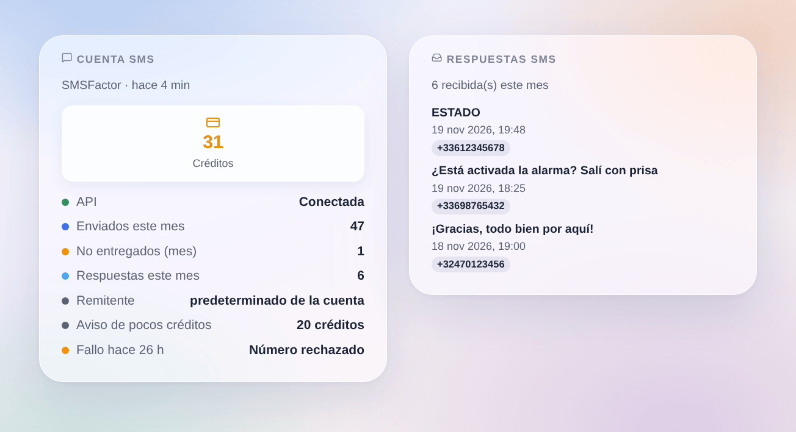
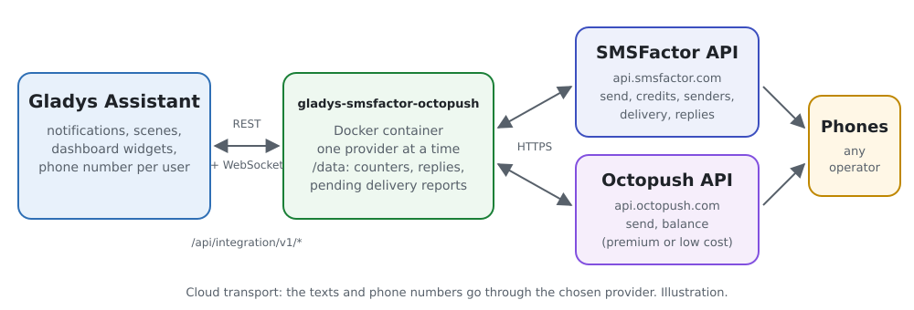
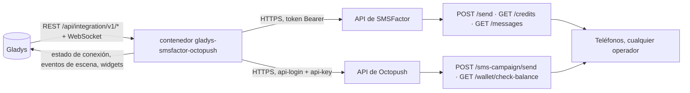
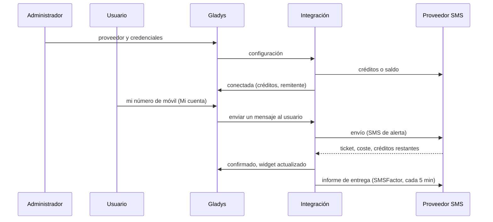

# Gladys SMSFactor + Octopush

[English](README.md) · [Français](README.fr.md) · [Deutsch](README.de.md) · **Español**

[](LICENSE)
[](https://github.com/William-De71/gladys-smsfactor-octopush/releases)
[](https://github.com/William-De71/gladys-smsfactor-octopush/actions/workflows/release.yml)
[](https://gladysassistant.com)



Integración externa de [Gladys Assistant](https://gladysassistant.com) que envía las notificaciones de Gladys **por SMS con SMSFactor u Octopush**, dos pasarelas SMS francesas, a cualquier número móvil y cualquier operador. Las escenas también pueden enviar un SMS a cualquiera y reaccionar a los SMS no entregados, a las respuestas y a los pocos créditos; dos widgets muestran la cuenta y las respuestas.

Documentación de usuario: [English](docs/en.md) · [Français](docs/fr.md) · [Deutsch](docs/de.md) · [Español](docs/es.md).

> Integración comunitaria, no afiliada a SMSFactor ni a Octopush ni respaldada por ellos.

## Funciones

- **Canal de notificación** (solo envío): cada usuario introduce su número de móvil en el bloque «Mi cuenta»; cada notificación de Gladys dirigida a él sale por SMS.
- **Dos proveedores**, uno elegido en la configuración: SMSFactor (token de API) u Octopush (usuario y clave de API, SMS premium o low cost).
- **SMS de alerta**: enviados a cualquier hora, sin mención «STOP»; Unicode solo cuando el texto lo necesita; los números nacionales reciben el prefijo por defecto.
- **Disparadores de escena**: SMS no enviado, SMS no entregado (SMSFactor), SMS recibido (respuestas de SMSFactor, filtros por remitente y primera palabra), pocos créditos.
- **Acciones de escena**: enviar un SMS a cualquier número, leer la cuenta SMS.
- **Widgets del panel**: cuenta SMS, respuestas SMS.
- **Botones de la pantalla de configuración**: probar la conexión, enviar un SMS de prueba.
- Inglés, francés, alemán y español en todas partes.



## Funcionamiento





De la configuración a un SMS:



| Función                           | SMSFactor        | Octopush            |
| --------------------------------- | ---------------- | ------------------- |
| Envío, acciones de escena         | sí               | sí                  |
| Pocos créditos                    | créditos SMS     | saldo en euros      |
| SMS no entregado                  | sí (cada 5 min)  | no (solo callbacks) |
| Respuestas (SMS recibido, widget) | sí (cada minuto) | no (solo callbacks) |
| Lista de remitentes               | sí               | no                  |

Octopush solo envía las entregas y respuestas a una URL pública, que un Gladys en casa no tiene.

### Transporte

`transports: ["cloud"]`: la integración solo habla con `api.smsfactor.com` o `api.octopush.com`. Los textos de los SMS y los números salen de su red hacia el proveedor y luego hacia los operadores móviles.

## Notificaciones y números

| Número escrito       | Enviado a                               |
| -------------------- | --------------------------------------- |
| `+33 6 12 34 56 78`  | `+33612345678`                          |
| `0033.6.12.34.56.78` | `+33612345678`                          |
| `06 12 34 56 78`     | `+33612345678` (prefijo por defecto 33) |
| `+34 612 34 56 78`   | `+34612345678`                          |

SMSFactor recibe los números sin el `+`. Una imagen adjunta se descarta. Un texto con un carácter fuera del alfabeto GSM (emoji, «ê», «œ») se envía en Unicode: 70 caracteres por SMS en lugar de 160.

## Disparadores, acciones y widgets

| Tipo       | Clave             | Caso de uso                                                                         |
| ---------- | ----------------- | ----------------------------------------------------------------------------------- |
| Disparador | `sms_not_sent`    | Avisar por otro canal cuando los SMS dejan de salir (créditos, credenciales, caída) |
| Disparador | `sms_undelivered` | Un SMS aceptado nunca llegó (informes de SMSFactor): enviarlo de otra forma         |
| Disparador | `sms_received`    | Reaccionar a una respuesta: una palabra clave como ESTADO de un número conocido     |
| Disparador | `credits_low`     | Recargar la cuenta antes de que se agote                                            |
| Acción     | `send_sms`        | SMS a alguien que no usa Gladys (vecino, niñera) o a varios números                 |
| Acción     | `get_account`     | Créditos y SMS del mes en un informe o una condición                                |
| Widget     | `account`         | Créditos o saldo, estado de la API, SMS del mes, remitente, umbral, último fallo    |
| Widget     | `inbox`           | Las últimas respuestas recibidas                                                    |

Ejemplos: _salta la alarma_ → SMS al vecino; _pocos créditos_ → mensaje al administrador; _SMS no entregado_ → el mismo aviso por Telegram. `sms_received` nunca debe abrir una puerta ni desactivar una alarma: el remitente de un SMS puede falsificarse. Una acción de escena nunca activa un disparador, y `sms_not_sent` solo se activa una vez hasta que pase un SMS: una escena que avisa por este mismo canal no puede entrar en bucle.

## Requisitos

- Gladys Assistant 5.3.0 o posterior (widgets y escenas, palabras clave del catálogo de Gladys 5.3); las instancias anteriores no pueden instalar la integración.
- Una cuenta de SMSFactor (token de API) o una cuenta validada de Octopush (usuario y clave de API), con créditos.

## Instalación

- **Desde la tienda**: Integraciones → SMSFactor + Octopush → Instalar.
- **Desde la URL del repositorio**: Integraciones → integración externa → `https://github.com/William-De71/gladys-smsfactor-octopush`.
- **Modo desarrollador**: ejecute `npm start` con las variables que da Gladys (ver Desarrollo).

## Configuración

| Campo                           | Por defecto     | Significado                                                    |
| ------------------------------- | --------------- | -------------------------------------------------------------- |
| Proveedor                       | SMSFactor       | SMSFactor u Octopush                                           |
| Token de API de SMSFactor       | —               | `secret`, desde Desarrolladores → Tokens API                   |
| Usuario de Octopush             | —               | El correo electrónico de la cuenta                             |
| Clave de API de Octopush        | —               | `secret`                                                       |
| Tipo de SMS de Octopush         | Premium         | Premium o low cost (solo Francia, sin remitente personalizado) |
| Remitente                       | el de la cuenta | 3 a 11 letras o cifras                                         |
| Prefijo del país por defecto    | 33              | Se añade a los números escritos sin prefijo                    |
| Aviso de pocos créditos         | 20 / 2 €        | Umbral de `credits_low`: créditos SMS, o euros con Octopush    |
| Leer las respuestas (SMSFactor) | desactivado     | Cada minuto, para `sms_received` y el widget de respuestas     |
| Mi cuenta → número              | —               | Por usuario: el número de móvil de sus notificaciones          |

## Uso

1. Elija el proveedor, rellene sus credenciales y pulse **Probar la conexión** y **Enviar un SMS de prueba**.
2. Cada usuario introduce su número de móvil en **Mi cuenta**.
3. Añada los widgets a un panel y cree escenas con los disparadores y las acciones.

## Desarrollo

```bash
npm install
npm test                       # node --test, nunca toca la red
npm run lint                   # ESLint
npm run format:check           # Prettier
npx github:GladysAssistant/integration-store . --skip-image-check
scripts/build-cover.sh         # cover.jpg a partir de docs/assets/cover.svg
docs/illustrations/render.sh   # docs/assets/widgets.<idioma>.png
```

En local, el SDK lee `GLADYS_HOST_API_URL`, `GLADYS_INTEGRATION_TOKEN` y `GLADYS_INTEGRATION_SELECTOR` (dados por Gladys en modo desarrollador). `DEBUG=gladys-integration-sdk` muestra los registros del SDK.

Las pruebas cubren ambos formatos de error (`status` de SMSFactor en HTTP 200, `{ code, message }` de Octopush), las causas de fallo, los reintentos (solo 429 y 503, un mismo `request_id` de Octopush para todos los intentos), las fechas de París de SMSFactor, el alfabeto GSM, los números, los eventos de escena y sus transiciones, las respuestas y los informes de entrega tras un reinicio, los widgets (`validateWidgetContent`), el manifiesto, los cuatro idiomas, el script de publicación y toda la integración frente al Gladys falso del SDK y a API falsas de SMSFactor y Octopush. `test/structure.test.js` congela todas las claves que guardan los usuarios.

## Proceso de publicación


Cada fusión en `main` lanza la CI y luego calcula la versión a partir de los [Conventional Commits](https://www.conventionalcommits.org/es/) desde la última etiqueta: `feat` → menor, `fix` / `perf` → parche, `!` o `BREAKING CHANGE` → mayor (una menor por debajo de 1.0.0); `docs`, `chore`, `ci`, `test`, `style`, `refactor`, `build` solos no publican nada. Se genera la sección del changelog, se sube la etiqueta, se construye la imagen multiarquitectura, después `main` recibe el commit de publicación, se crea la GitHub Release y un último job comprueba la imagen pública, el validador de la tienda y el topic.

- El título de la pull request se convierte en el commit squash y luego en la línea del changelog: escríbalo en inglés, para el usuario (`pr-title.yml` lo comprueba). No edite nunca `CHANGELOG.md` a mano.
- 1.0.0 es una decisión: Actions → Release → Run workflow con `release-as: 1.0.0`. `dry-run` muestra la versión y las notas sin publicar.
- **Rama protegida**: la publicación sube su commit a `main` con `GITHUB_TOKEN`. Con un ruleset en `main`, añada GitHub Actions a su lista de omisión (o suba con una GitHub App); si no, el job de publicación falla con instrucciones.
- Tras la primera publicación, haga público el paquete `ghcr.io` (Package settings → Change visibility), o Gladys no podrá descargarlo.

## Solución de problemas

Vea [docs/es.md](docs/es.md#solución-de-problemas). Informe de los problemas con las versiones de Gladys y de la integración, el proveedor, el tipo de remitente y los registros de la integración (los números aparecen enmascarados; no pegue nunca el token ni la clave).

## Contribuir

Las issues y pull requests son bienvenidas. Ejecute `npm run format:check && npm run lint && npm test` antes de abrir una pull request y no cambie ninguna clave guardada (vea [CLAUDE.md](CLAUDE.md)).

## Seguridad

Vea [SECURITY.md](SECURITY.md): informe de las vulnerabilidades en privado. El token de SMSFactor y la clave de API de Octopush son campos `secret`, se envían solo en cabeceras, nunca se registran, nunca van en una URL, un evento de escena o un mensaje de error; los números aparecen enmascarados en los registros. Un envío de SMSFactor nunca se reintenta tras agotar el tiempo, para que un aviso no salga dos veces; los envíos de Octopush llevan un identificador de petición que Octopush no acepta dos veces.

## Capturas por venir

Las imágenes de arriba son ilustraciones, no capturas de pantalla. Las capturas reales irán en `docs/assets/screenshots/` (PNG, 1280 × 800): `configuration.png`, `my-account.png`, `scene-trigger.png`, `dashboard.png`.

## Licencia

[Licencia Apache 2.0](LICENSE) — vea también [NOTICE](NOTICE). SMSFactor y Octopush son marcas de sus respectivos propietarios; esta integración comunitaria no está afiliada a ellos. Gracias a la documentación y al SDK de Gladys.
