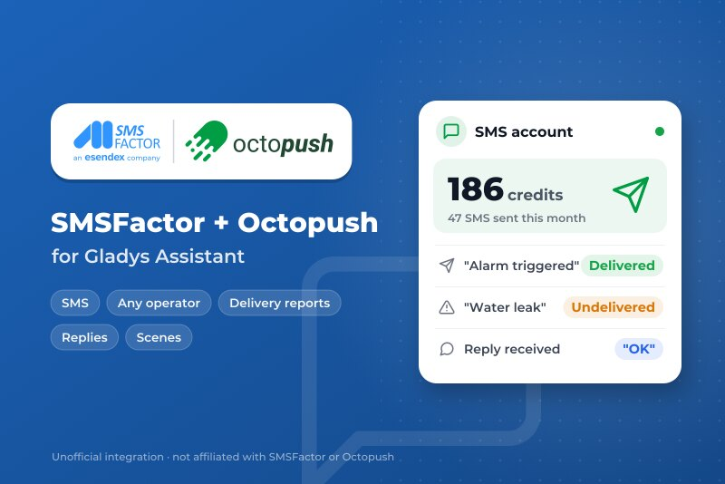
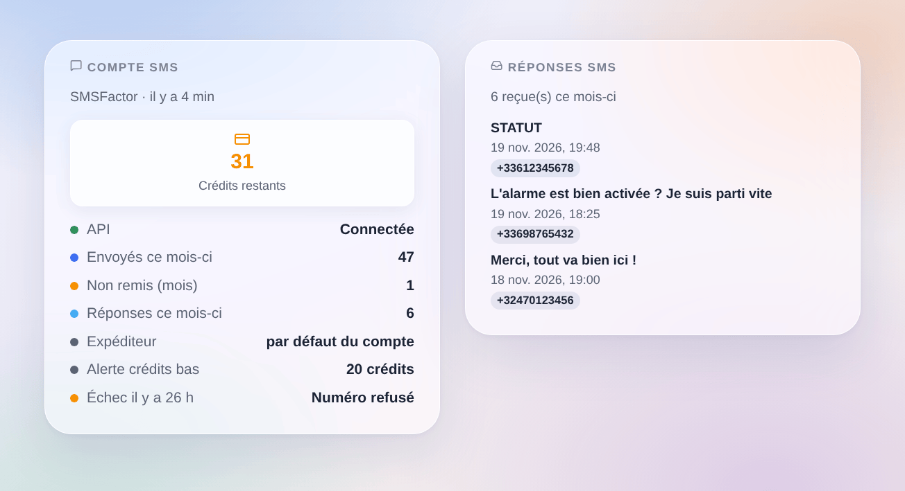
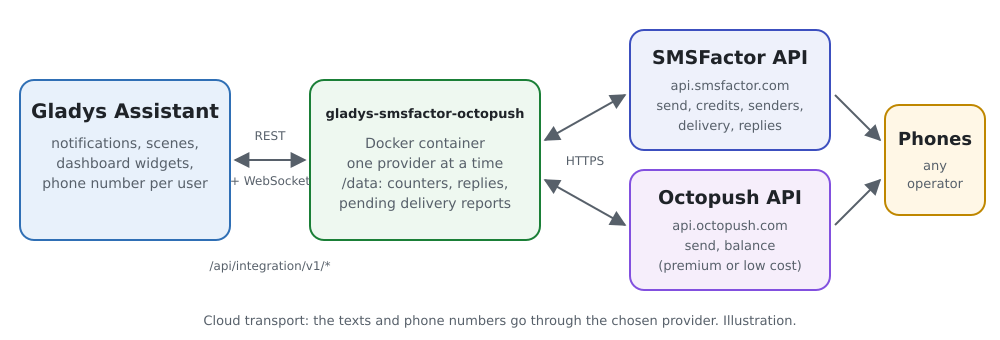
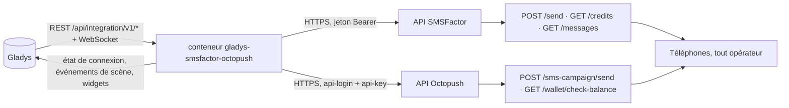
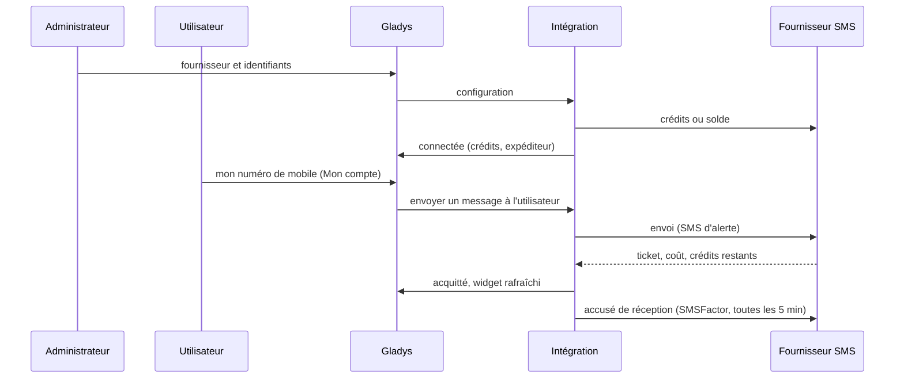

# Gladys SMSFactor + Octopush

[English](README.md) · **Français** · [Deutsch](README.de.md) · [Español](README.es.md)

[](LICENSE)
[](https://github.com/William-De71/gladys-smsfactor-octopush/releases)
[](https://github.com/William-De71/gladys-smsfactor-octopush/actions/workflows/release.yml)
[](https://gladysassistant.com)



Intégration externe de [Gladys Assistant](https://gladysassistant.com) qui envoie les notifications de Gladys **par SMS via SMSFactor ou Octopush**, deux passerelles SMS françaises, vers n'importe quel numéro de mobile et n'importe quel opérateur. Les scènes peuvent aussi envoyer un SMS à n'importe qui, réagir aux SMS non remis, aux réponses et aux crédits bas, et deux widgets affichent le compte et les réponses.

Documentation utilisateur : [English](docs/en.md) · [Français](docs/fr.md) · [Deutsch](docs/de.md) · [Español](docs/es.md).

> Intégration communautaire, ni affiliée à SMSFactor ou Octopush, ni approuvée par eux.

## Fonctionnalités

- **Canal de notification** (envoi seul) : chaque utilisateur saisit son numéro de mobile dans le bloc « Mon compte » ; chaque notification Gladys qui lui est adressée part par SMS.
- **Deux fournisseurs**, un seul choisi dans la configuration : SMSFactor (jeton d'API) ou Octopush (identifiant et clé d'API, SMS premium ou low cost).
- **SMS d'alerte** : envoyés à toute heure, sans mention « STOP » ; Unicode seulement si le texte l'exige ; les numéros nationaux reçoivent l'indicatif par défaut.
- **Déclencheurs de scène** : SMS non envoyé, SMS non remis (SMSFactor), SMS reçu (réponses SMSFactor, filtres sur l'expéditeur et le premier mot), crédits bas.
- **Actions de scène** : envoyer un SMS à n'importe quel numéro, lire le compte SMS.
- **Widgets du tableau de bord** : compte SMS, réponses SMS.
- **Boutons de l'écran de configuration** : tester la connexion, envoyer un SMS de test.
- Anglais, français, allemand et espagnol partout.



## Fonctionnement





De la configuration à un SMS :



| Fonction                    | SMSFactor              | Octopush                  |
| --------------------------- | ---------------------- | ------------------------- |
| Envoi, actions de scène     | oui                    | oui                       |
| Crédits bas                 | crédits SMS            | solde en euros            |
| SMS non remis               | oui (toutes les 5 min) | non (callbacks seulement) |
| Réponses (SMS reçu, widget) | oui (chaque minute)    | non (callbacks seulement) |
| Liste des expéditeurs       | oui                    | non                       |

Octopush ne transmet les accusés de réception et les réponses qu'à une URL publique, qu'un Gladys à la maison n'a pas.

### Transport

`transports: ["cloud"]` : l'intégration ne parle qu'à `api.smsfactor.com` ou `api.octopush.com`. Les textes des SMS et les numéros quittent votre réseau vers le fournisseur, puis les opérateurs mobiles.

## Notifications et numéros

| Numéro saisi         | Envoyé à                                 |
| -------------------- | ---------------------------------------- |
| `+33 6 12 34 56 78`  | `+33612345678`                           |
| `0033.6.12.34.56.78` | `+33612345678`                           |
| `06 12 34 56 78`     | `+33612345678` (indicatif par défaut 33) |
| `+32 470 12 34 56`   | `+32470123456`                           |

SMSFactor reçoit les numéros sans le `+`. Une image jointe à un message est ignorée. Un texte avec un caractère hors de l'alphabet GSM (emoji, « ê », « œ ») part en Unicode : 70 caractères par SMS au lieu de 160.

## Déclencheurs, actions et widgets

| Type        | Clé               | Cas d'usage                                                                              |
| ----------- | ----------------- | ---------------------------------------------------------------------------------------- |
| Déclencheur | `sms_not_sent`    | Prévenir par un autre canal quand les SMS ne partent plus (crédits, identifiants, panne) |
| Déclencheur | `sms_undelivered` | Un SMS accepté n'est jamais arrivé (rapports SMSFactor) : l'envoyer autrement            |
| Déclencheur | `sms_received`    | Réagir à une réponse : un mot-clé comme STATUT d'un numéro connu (SMSFactor)             |
| Déclencheur | `credits_low`     | Recharger le compte avant qu'il soit vide                                                |
| Action      | `send_sms`        | SMS à quelqu'un qui n'utilise pas Gladys (voisin, nounou), ou à plusieurs numéros        |
| Action      | `get_account`     | Crédits et SMS du mois dans un compte rendu ou une condition                             |
| Widget      | `account`         | Crédits ou solde, état de l'API, SMS du mois, expéditeur, seuil, dernier échec           |
| Widget      | `inbox`           | Les dernières réponses reçues                                                            |

Exemples : _l'alarme se déclenche_ → SMS au voisin ; _crédits bas_ → message à l'administrateur ; _SMS non remis_ → même alerte par Telegram. `sms_received` ne doit jamais ouvrir une porte ni désarmer une alarme : l'expéditeur d'un SMS peut être falsifié. Une action de scène ne déclenche jamais de déclencheur, et `sms_not_sent` ne se déclenche qu'une fois tant qu'aucun SMS n'est passé : une scène qui prévient par ce même canal ne peut pas boucler.

## Prérequis

- Gladys Assistant 5.3.0 ou plus récent (widgets et scènes, mots-clés du catalogue de Gladys 5.3) ; les instances plus anciennes ne peuvent pas installer l'intégration.
- Un compte SMSFactor (jeton d'API) ou un compte Octopush validé (identifiant et clé d'API), avec des crédits.

## Installation

- **Depuis le store** : Intégrations → SMSFactor + Octopush → Installer.
- **Depuis l'URL du dépôt** : Intégrations → intégration externe → `https://github.com/William-De71/gladys-smsfactor-octopush`.
- **Mode développeur** : lancez `npm start` avec les variables fournies par Gladys (voir Développement).

## Configuration

| Champ                         | Défaut          | Rôle                                                                 |
| ----------------------------- | --------------- | -------------------------------------------------------------------- |
| Fournisseur                   | SMSFactor       | SMSFactor ou Octopush                                                |
| Jeton d'API SMSFactor         | —               | `secret`, depuis Développeurs → Tokens API                           |
| Identifiant Octopush          | —               | L'adresse e-mail du compte                                           |
| Clé d'API Octopush            | —               | `secret`                                                             |
| Type de SMS Octopush          | Premium         | Premium ou low cost (France seulement, sans expéditeur personnalisé) |
| Expéditeur                    | celui du compte | 3 à 11 lettres ou chiffres                                           |
| Indicatif du pays par défaut  | 33              | Ajouté aux numéros saisis sans indicatif                             |
| Alerte de crédits bas         | 20 / 2 €        | Seuil de `credits_low` : crédits SMS, ou euros avec Octopush         |
| Lire les réponses (SMSFactor) | désactivé       | Chaque minute, pour `sms_received` et le widget des réponses         |
| Mon compte → numéro           | —               | Par utilisateur : le numéro de mobile de ses notifications           |

## Utilisation

1. Choisissez le fournisseur, remplissez ses identifiants, puis cliquez sur **Tester la connexion** et **Envoyer un SMS de test**.
2. Chaque utilisateur saisit son numéro de mobile dans **Mon compte**.
3. Ajoutez les widgets à un tableau de bord, et construisez des scènes avec les déclencheurs et les actions.

## Développement

```bash
npm install
npm test                       # node --test, ne touche jamais le réseau
npm run lint                   # ESLint
npm run format:check           # Prettier
npx github:GladysAssistant/integration-store . --skip-image-check
scripts/build-cover.sh         # cover.jpg depuis docs/assets/cover.svg
docs/illustrations/render.sh   # docs/assets/widgets.<langue>.png
```

En local, le SDK lit `GLADYS_HOST_API_URL`, `GLADYS_INTEGRATION_TOKEN` et `GLADYS_INTEGRATION_SELECTOR` (fournies par Gladys en mode développeur). `DEBUG=gladys-integration-sdk` affiche les journaux du SDK.

Les tests couvrent les deux formats d'erreur (`status` de SMSFactor en HTTP 200, `{ code, message }` d'Octopush), les causes d'échec, les relances (429 et 503 seulement, un même `request_id` Octopush pour toutes les tentatives), les dates de Paris de SMSFactor, l'alphabet GSM, les numéros, les événements de scène et leurs transitions, les réponses et les accusés de réception après un redémarrage, les widgets (`validateWidgetContent`), le manifeste, les quatre langues, le script de release, et toute l'intégration face au faux Gladys du SDK et à de fausses API SMSFactor et Octopush. `test/structure.test.js` fige toutes les clés que les utilisateurs enregistrent.

## Processus de release


Chaque fusion sur `main` lance la CI, puis calcule la version à partir des [Conventional Commits](https://www.conventionalcommits.org/fr/) depuis le dernier tag : `feat` → mineure, `fix` / `perf` → correctif, `!` ou `BREAKING CHANGE` → majeure (une mineure sous 1.0.0) ; `docs`, `chore`, `ci`, `test`, `style`, `refactor`, `build` seuls ne publient rien. La section du changelog est générée, le tag poussé, l'image multi-architecture construite, puis `main` reçoit le commit de release, la GitHub Release est créée et un dernier job vérifie l'image publique, le validateur du store et le topic.

- Le titre de la pull request devient le commit squash, puis la ligne du changelog : écrivez-le en anglais, pour l'utilisateur (`pr-title.yml` le vérifie). N'éditez jamais `CHANGELOG.md` à la main.
- 1.0.0 est une décision : Actions → Release → Run workflow avec `release-as: 1.0.0`. `dry-run` affiche la version et les notes sans rien publier.
- **Branche protégée** : des rulesets imposent une pull request sur `main` et verrouillent les tags `v*` ; seuls le mainteneur et les deploy keys passent. La release pousse avec la deploy key de l’environnement `release` (secret `RELEASE_DEPLOY_KEY`, `main` seulement) : un run lancé depuis une autre branche ne l’obtient jamais. `build.yml` et `github-release.yml` ne démarrent pas sur un tag : la release les appelle, ou lancez-les à la main (Actions → Run workflow, avec `version` pour l’image) pour terminer une release.
- Après la première release, rendez public le package `ghcr.io` (Package settings → Change visibility), sinon Gladys ne peut pas le télécharger.

## Dépannage

Voir [docs/fr.md](docs/fr.md#dépannage). Signalez les problèmes avec les versions de Gladys et de l'intégration, le fournisseur, le type d'expéditeur et les journaux de l'intégration (les numéros sont masqués ; ne collez jamais le jeton ni la clé).

## Contribuer

Les issues et pull requests sont les bienvenues. Lancez `npm run format:check && npm run lint && npm test` avant d'ouvrir une pull request, et ne changez aucune clé enregistrée (voir [CLAUDE.md](CLAUDE.md)).

## Sécurité

Voir [SECURITY.md](SECURITY.md) : signalez les vulnérabilités en privé. Le jeton SMSFactor et la clé d'API Octopush sont des champs `secret`, envoyés seulement dans des en-têtes, jamais journalisés, jamais dans une URL, un événement de scène ou un message d'erreur ; les numéros sont masqués dans les journaux. Un envoi SMSFactor n'est jamais relancé après un délai dépassé, pour qu'une alerte ne parte pas deux fois ; les envois Octopush portent un identifiant de requête qu'Octopush refuse deux fois.

## Captures à venir

Les images ci-dessus sont des illustrations, pas des captures d'écran. Les vraies captures iront dans `docs/assets/screenshots/` (PNG, 1280 × 800) : `configuration.png`, `my-account.png`, `scene-trigger.png`, `dashboard.png`.

## Licence

[Licence Apache 2.0](LICENSE) — voir aussi [NOTICE](NOTICE). SMSFactor et Octopush sont des marques de leurs propriétaires respectifs ; cette intégration communautaire ne leur est pas affiliée. Merci à la documentation et au SDK de Gladys.
