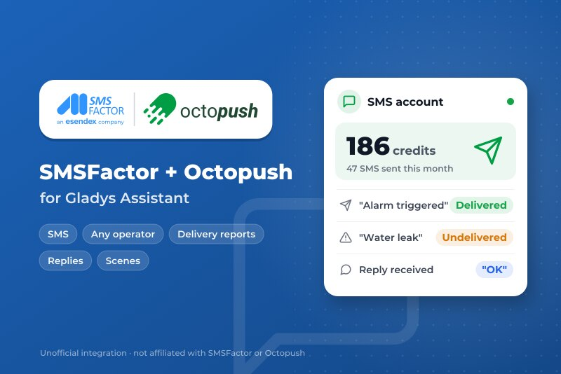
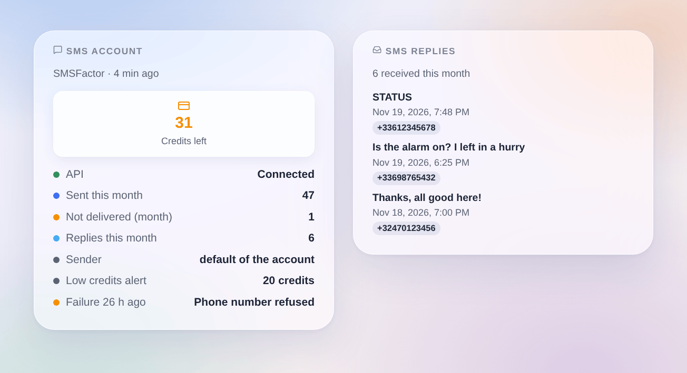
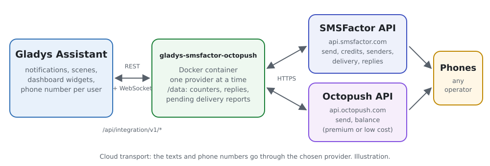
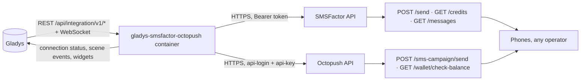
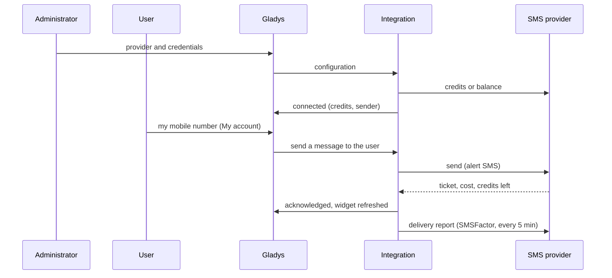

# Gladys SMSFactor + Octopush

**English** · [Français](README.fr.md) · [Deutsch](README.de.md) · [Español](README.es.md)

[](LICENSE)
[](https://github.com/William-De71/gladys-smsfactor-octopush/releases)
[](https://github.com/William-De71/gladys-smsfactor-octopush/actions/workflows/release.yml)
[](https://gladysassistant.com)



[Gladys Assistant](https://gladysassistant.com) external integration that sends the notifications of Gladys **by SMS through SMSFactor or Octopush**, two French SMS gateways, to any mobile number and any operator. Scenes can also send an SMS to anyone, react to undelivered SMS, to replies and to low credits, and two dashboard widgets show the account and the replies.

User documentation: [English](docs/en.md) · [Français](docs/fr.md) · [Deutsch](docs/de.md) · [Español](docs/es.md).

> Community integration, not affiliated with nor endorsed by SMSFactor or Octopush.

## Features

- **Notification channel** (send-only): each user enters their mobile number in the "My account" block; every Gladys notification addressed to them leaves by SMS.
- **Two providers**, one chosen in the configuration: SMSFactor (API token) or Octopush (login and API key, premium or low cost SMS).
- **Alert SMS**: sent at any hour, without a "STOP" mention; Unicode only when the text needs it; national numbers get the default country code.
- **Scene triggers**: SMS not sent, SMS not delivered (SMSFactor), SMS received (SMSFactor replies, filters on the sender and the first word), credits low.
- **Scene actions**: send an SMS to any number, read the SMS account.
- **Dashboard widgets**: SMS account, SMS replies.
- **Configuration screen buttons**: test the connection, send a test SMS.
- English, French, German and Spanish everywhere.



## How it works





From the configuration to an SMS:



| Feature                        | SMSFactor          | Octopush            |
| ------------------------------ | ------------------ | ------------------- |
| Sending, scene actions         | yes                | yes                 |
| Credits low                    | SMS credits        | balance in euros    |
| SMS not delivered              | yes (every 5 min)  | no (callbacks only) |
| Replies (SMS received, widget) | yes (every minute) | no (callbacks only) |
| Senders listed                 | yes                | no                  |

Octopush tells deliveries and replies only to a public URL, which a Gladys at home does not have.

### Transport

`transports: ["cloud"]`: the integration only talks to `api.smsfactor.com` or `api.octopush.com`. The texts of the SMS and the phone numbers leave your network for the provider, then the mobile operators.

## Notifications and phone numbers

| Typed number         | Sent to                                  |
| -------------------- | ---------------------------------------- |
| `+33 6 12 34 56 78`  | `+33612345678`                           |
| `0033.6.12.34.56.78` | `+33612345678`                           |
| `06 12 34 56 78`     | `+33612345678` (default country code 33) |
| `+32 470 12 34 56`   | `+32470123456`                           |

SMSFactor receives the numbers without the `+`. A picture attached to a message is dropped. A text with a character outside the GSM alphabet (emoji, "ê", "œ") is sent in Unicode: 70 characters per SMS instead of 160.

## Scene triggers, actions and widgets

| Kind    | Key               | Use case                                                                              |
| ------- | ----------------- | ------------------------------------------------------------------------------------- |
| Trigger | `sms_not_sent`    | Warn through another channel when SMS stop leaving (credits, credentials, outage)     |
| Trigger | `sms_undelivered` | An accepted SMS never reached the phone (SMSFactor reports): send it another way      |
| Trigger | `sms_received`    | React to a reply: a keyword such as STATUS from a known number (SMSFactor)            |
| Trigger | `credits_low`     | Top up the account before it runs dry                                                 |
| Action  | `send_sms`        | SMS to someone who is not a Gladys user (neighbor, babysitter), or to several numbers |
| Action  | `get_account`     | Credits and SMS of the month in a report or a condition                               |
| Widget  | `account`         | Credits or balance, API state, SMS of the month, sender, threshold, last failure      |
| Widget  | `inbox`           | The last replies received                                                             |

Examples: _alarm goes off_ → SMS to the neighbor; _credits low_ → message to the administrator; _SMS not delivered_ → same alert through Telegram. `sms_received` must never open a door or disarm an alarm: an SMS sender can be forged. A scene action never fires a trigger, and `sms_not_sent` fires once until an SMS goes through: a scene warning through this same channel cannot loop.

## Requirements

- Gladys Assistant 5.3.0 or later (widgets and scenes, catalog keywords of Gladys 5.3); older instances cannot install the integration.
- A SMSFactor account (API token) or a validated Octopush account (login and API key), with credits.

## Installation

- **From the store**: Integrations → SMSFactor + Octopush → Install.
- **From the repository URL**: Integrations → external integration → `https://github.com/William-De71/gladys-smsfactor-octopush`.
- **Developer mode**: run `npm start` with the variables given by Gladys (see Development).

## Configuration

| Field                        | Default         | Meaning                                                         |
| ---------------------------- | --------------- | --------------------------------------------------------------- |
| Provider                     | SMSFactor       | SMSFactor or Octopush                                           |
| SMSFactor API token          | —               | `secret`, from Developers → API tokens                          |
| Octopush login               | —               | The e-mail address of the account                               |
| Octopush API key             | —               | `secret`                                                        |
| Octopush SMS type            | Premium         | Premium or low cost (France only, no custom sender)             |
| Sender                       | account default | 3 to 11 letters or digits                                       |
| Default country code         | 33              | Added to numbers typed without one                              |
| Low credits alert            | 20 / 2 €        | Threshold of `credits_low`: SMS credits, or euros with Octopush |
| Read the replies (SMSFactor) | off             | Every minute, for `sms_received` and the replies widget         |
| My account → number          | —               | Per user: the mobile number of their notifications              |

## Usage

1. Choose the provider, fill in its credentials, then click **Test the connection** and **Send a test SMS**.
2. Each user enters their mobile number in **My account**.
3. Add the widgets to a dashboard, and build scenes with the triggers and actions.

## Development

```bash
npm install
npm test                       # node --test, never touches the network
npm run lint                   # ESLint
npm run format:check           # Prettier
npx github:GladysAssistant/integration-store . --skip-image-check
scripts/build-cover.sh         # cover.jpg from docs/assets/cover.svg
docs/illustrations/render.sh   # docs/assets/widgets.<lang>.png
```

Locally, the SDK reads `GLADYS_HOST_API_URL`, `GLADYS_INTEGRATION_TOKEN` and `GLADYS_INTEGRATION_SELECTOR` (given by Gladys in developer mode). `DEBUG=gladys-integration-sdk` shows the SDK logs.

The tests cover both error formats (SMSFactor `status` in HTTP 200, Octopush `{ code, message }`), the failure reasons, the retries (429 and 503 only, one Octopush `request_id` for every attempt), the Paris dates of SMSFactor, the GSM alphabet, the phone numbers, the scene events and their transitions, the replies and the delivery reports across a restart, the widgets (`validateWidgetContent`), the manifest, the four languages, the release script, and the whole integration against the fake Gladys of the SDK and fake SMSFactor and Octopush APIs. `test/structure.test.js` freezes every key users store.

## Release process


Every merge on `main` runs the CI, then computes the version from the [Conventional Commits](https://www.conventionalcommits.org/) since the last tag: `feat` → minor, `fix` / `perf` → patch, `!` or `BREAKING CHANGE` → major (a minor below 1.0.0); `docs`, `chore`, `ci`, `test`, `style`, `refactor`, `build` alone publish nothing. The changelog section is generated, the tag pushed, the multi-architecture image built, then `main` receives the release commit, the GitHub Release is created and a last job checks the public image, the store validator and the topic.

- The pull request title becomes the squash commit, then the changelog line: write it in English, for the user (`pr-title.yml` checks it). Never edit `CHANGELOG.md` by hand.
- 1.0.0 is a decision: Actions → Release → Run workflow with `release-as: 1.0.0`. `dry-run` shows the version and the notes without publishing.
- **Protected branch**: rulesets require a pull request on `main` and lock the `v*` tags; only the maintainer and deploy keys get through. The release pushes with the deploy key of the `release` environment (secret `RELEASE_DEPLOY_KEY`, `main` only): a run from another branch never gets it. `build.yml` and `github-release.yml` do not start on a tag: the release calls them, or run them by hand (Actions → Run workflow, with `version` for the image) to finish a release.
- After the first release, make the `ghcr.io` package public (Package settings → Change visibility), or Gladys cannot pull it.

## Troubleshooting

See [docs/en.md](docs/en.md#troubleshooting). Report issues with the versions of Gladys and of the integration, the provider, the kind of sender and the logs of the integration (phone numbers are masked; never paste the token or the key).

## Contributing

Issues and pull requests are welcome. Run `npm run format:check && npm run lint && npm test` before opening a pull request, and keep every stored key unchanged (see [CLAUDE.md](CLAUDE.md)).

## Security

See [SECURITY.md](SECURITY.md): report vulnerabilities privately. The SMSFactor token and the Octopush API key are `secret` fields, sent in headers only, never logged, never in a URL, a scene event or an error message; phone numbers are masked in the logs. A send is never retried after a timeout with SMSFactor, so an alert is not sent twice; Octopush sends carry a request id it refuses twice.

## Screenshots to come

The images above are illustrations, not screenshots. Real screenshots will go in `docs/assets/screenshots/` (PNG, 1280 × 800): `configuration.png`, `my-account.png`, `scene-trigger.png`, `dashboard.png`.

## License

[Apache License 2.0](LICENSE) — see also [NOTICE](NOTICE). SMSFactor and Octopush are trademarks of their respective owners; this community integration is not affiliated with them. Thanks to the Gladys documentation and SDK.
