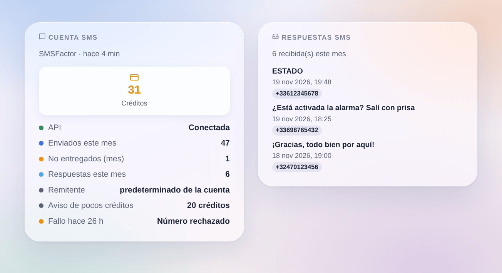

# SMSFactor + Octopush

## Presentación

Esta integración envía las notificaciones de Gladys por SMS a través de una de
dos pasarelas SMS francesas, [SMSFactor](https://www.smsfactor.com) u
[Octopush](https://www.octopush.com), a cualquier número móvil y cualquier
operador. Cada usuario de Gladys introduce su propio número; el administrador
elige el proveedor e introduce sus credenciales una vez para toda la casa.

También aporta:

- cuatro **disparadores de escena**: SMS no enviado, SMS no entregado, SMS
  recibido, pocos créditos;
- dos **acciones de escena**: enviar un SMS a cualquier número (incluso a
  alguien que no usa Gladys), leer la cuenta SMS;
- dos **widgets del panel**: la cuenta SMS y las respuestas SMS.

|                                   | SMSFactor              | Octopush            |
| --------------------------------- | ---------------------- | ------------------- |
| Envío, acciones de escena         | Sí                     | Sí                  |
| Pocos créditos                    | En créditos SMS        | En euros (saldo)    |
| SMS no entregado (informes)       | Sí, leídos cada 5 min  | No (solo callbacks) |
| Respuestas (SMS recibido, widget) | Sí, leídas cada minuto | No (solo callbacks) |
| Lista de remitentes               | Sí                     | No                  |
| Tipo de SMS                       | Uno                    | Premium o low cost  |

Octopush solo envía los acuses de entrega y las respuestas a una dirección web
pública, que un Gladys instalado en casa no tiene: con Octopush, la
integración solo envía.

Transporte: **nube**. Los textos y los números pasan por la API del proveedor
(`api.smsfactor.com` o `api.octopush.com`) y luego por los operadores móviles.

## Requisitos previos

- Gladys Assistant **5.3.0** o posterior.
- Una cuenta en **SMSFactor** u **Octopush** con créditos. Cada SMS consume
  créditos, más para un texto largo, un emoji o un número extranjero.
- SMSFactor: un **token de API** (Desarrolladores → Tokens API en su cuenta).
- Octopush: el **usuario** (correo electrónico) y la **clave de API** de la
  cuenta, y una cuenta **validada** por Octopush (registro terminado).
- Opcional: un **remitente** con nombre (3 a 11 letras o cifras, como
  `GLADYS`). Algunos países exigen registrarlo antes. No se puede responder a
  un remitente con nombre.

## Configuración

1. En Gladys, abra **Integraciones → SMSFactor + Octopush → Configuración**.
2. Elija el **proveedor**.
3. Rellene solo las credenciales de ese proveedor: el **token de API de
   SMSFactor**, o el **usuario** y la **clave de API de Octopush** (y su tipo
   de SMS). Guarde.
4. Pulse **Probar la conexión**: muestra los créditos o el saldo y, con
   SMSFactor, los remitentes. **Enviar un SMS de prueba** comprueba toda la
   cadena.
5. Cada usuario abre el bloque **Mi cuenta** de la misma pantalla e introduce
   su **número de móvil**.

| Campo                           | Uso                                                                                                     |
| ------------------------------- | ------------------------------------------------------------------------------------------------------- |
| Proveedor                       | SMSFactor u Octopush                                                                                    |
| Token de API de SMSFactor       | Desde Desarrolladores → Tokens API, guardado cifrado                                                    |
| Usuario de Octopush             | El correo electrónico de la cuenta de Octopush                                                          |
| Clave de API de Octopush        | Desde el apartado API del sitio de Octopush, guardada cifrada                                           |
| Tipo de SMS de Octopush         | Premium (rápido, remitente propio, todos los países) o low cost (solo Francia, más barato)              |
| Remitente                       | Opcional: 3 a 11 letras o cifras; vacío = el predeterminado de la cuenta                                |
| Prefijo del país por defecto    | Se añade a los números sin prefijo (`33` por defecto: 06… pasa a ser +336…)                             |
| Aviso de pocos créditos         | Por debajo de esta cantidad, «Pocos créditos» se activa una vez (vacío: 20 créditos o 2 € con Octopush) |
| Leer las respuestas (SMSFactor) | Lee las respuestas cada minuto, para «SMS recibido» y el widget de respuestas                           |

Los SMS salen como **alertas** (transaccionales), no como publicidad: se
envían a cualquier hora, sin mención «STOP». Use la integración solo para las
notificaciones de su casa.

## Uso

### Notificaciones

Cada notificación de Gladys dirigida a un usuario que introdujo un número sale
por SMS: alarmas, acciones de escena «Enviar un mensaje», respuestas de Gladys.
Una imagen adjunta se descarta (un SMS solo lleva texto). Un texto con un
carácter fuera del alfabeto SMS (un emoji, «ê», «œ») se envía en Unicode, es
decir 70 caracteres por SMS en lugar de 160.

### Disparadores de escena

| Disparador       | Cuándo se activa                                                                                                 | Variables                                     |
| ---------------- | ---------------------------------------------------------------------------------------------------------------- | --------------------------------------------- |
| SMS no enviado   | Con el primer fallo de una notificación y solo de nuevo después de que pase un SMS (nunca en bucle)              | causa, código HTTP, error, número enmascarado |
| SMS no entregado | SMSFactor aceptó un SMS pero indica que nunca llegó (se consulta durante 48 horas tras el envío)                 | número enmascarado, estado, detalles, ticket  |
| SMS recibido     | Cada nueva respuesta en la cuenta de SMSFactor, filtrada por remitente y primera palabra («Leer las respuestas») | remitente, texto, primera palabra, fecha      |
| Pocos créditos   | Los créditos o el saldo bajaron del umbral; de nuevo solo tras una recarga por encima                            | cantidad restante, umbral, unidad, proveedor  |

Las respuestas solo llegan para los SMS enviados **sin remitente
personalizado**, y solo en los países donde SMSFactor las permite (Francia,
Bélgica, Suiza). **No use nunca «SMS recibido» para abrir una puerta o
desactivar una alarma**: cualquiera puede enviar un SMS con un número
falsificado.

### Acciones de escena

- **Enviar un SMS a un número**: uno o varios números separados por comas y un
  texto (se admiten variables de escena). Devuelve los SMS enviados, los
  números no reconocidos, los números filtrados por el proveedor y los
  créditos usados y restantes.
- **Leer la cuenta SMS**: devuelve los créditos o el saldo restantes con su
  unidad, los SMS enviados, recibidos y no entregados este mes y el
  proveedor.

### Ejemplos de escenas

- _Cuando salta la alarma_ → enviar un SMS al vecino: «Alarma en casa, ¿puedes
  echar un vistazo?».
- _Cuando quedan pocos créditos_ → enviar un mensaje al administrador: «Solo
  quedan {{triggerEvent.data.credits_left}} en la cuenta SMS».
- _Cuando un SMS no se entrega_ → reenviar el aviso por otro canal (Telegram,
  correo electrónico).

### Widgets del panel

- **Cuenta SMS**: créditos o saldo restantes (naranja cerca del umbral, rojo
  por debajo), el estado de la API, los SMS enviados, recibidos y no
  entregados este mes, el remitente, el umbral y el último fallo.
- **Respuestas SMS**: las últimas respuestas recibidas (SMSFactor); toque una
  para leerla entera.

## Solución de problemas

- **«rechaza las credenciales»**: el token de SMSFactor se eliminó o la clave
  de API de Octopush se regeneró: copie la actual.
- **«aún no está validada»** (Octopush): complete los pasos de registro en el
  sitio de Octopush.
- **«Remitente rechazado»**: el remitente no está registrado o no está
  permitido para ese país: vacíe el campo para usar el predeterminado de la
  cuenta.
- **«País no autorizado»**: SMSFactor necesita una autorización para enviar a
  otro país distinto del de la cuenta.
- **«Número bloqueado (STOP)»**: el destinatario respondió STOP alguna vez, o
  el número se sabe inaccesible.
- **No llega ninguna respuesta**: hacen falta SMSFactor, un SMS enviado sin
  remitente personalizado y «Leer las respuestas» activado.
- **Registros**: Integraciones → SMSFactor + Octopush → pestaña Supervisión.
  Los números aparecen enmascarados; el token y la clave nunca aparecen.
